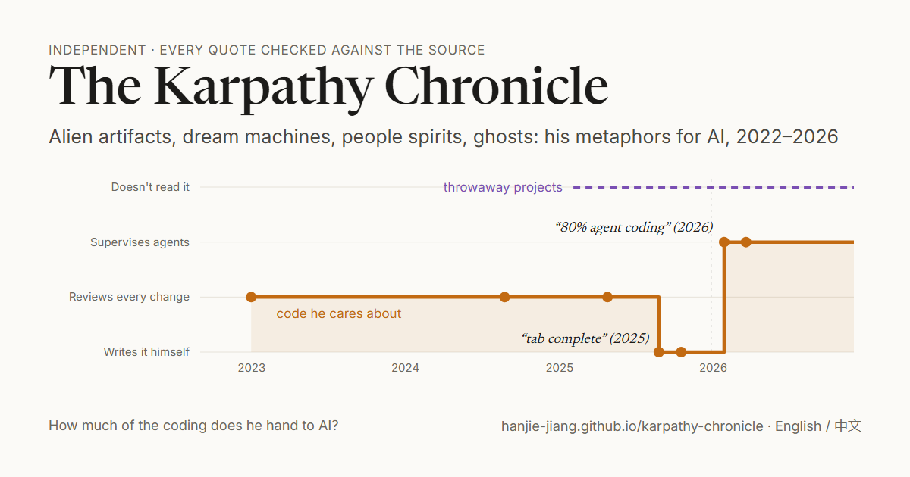

# The Karpathy Chronicle

**Read it: https://hanjie-jiang.github.io/karpathy-chronicle/** · [中文版](https://hanjie-jiang.github.io/karpathy-chronicle/?lang=zh)

Alien artifacts, dream machines, people spirits, ghosts: the metaphors Andrej Karpathy uses to explain AI, and how his thinking changed from 2022 to 2026, from a full read of all 868 of his X posts since 2022, plus his talks, interviews and blog posts. Every quote links to its source and is checked word for word before each build. Our interpretations are labelled as ours.

## What we found

1. **[His own coding didn't climb steadily toward AI. It dipped, then jumped.](https://hanjie-jiang.github.io/karpathy-chronicle/#finding-1)** The year he named vibe coding, his serious code was still mostly autocomplete. The jump came in December 2025.
2. **[Even at peak automation, he kept a line between throwaway and production code.](https://hanjie-jiang.github.io/karpathy-chronicle/#finding-2)** He stopped typing code, but still says "(but don't do this in prod!)".
3. **[Checking didn't disappear when he stopped reading code. It moved into the setup.](https://hanjie-jiang.github.io/karpathy-chronicle/#finding-3)** From "It's about staring at the code" to "give it success criteria and watch it go".
4. **[In five months he went from "learn along the way" to "remove yourself as the bottleneck".](https://hanjie-jiang.github.io/karpathy-chronicle/#finding-4)** He keeps one thing for the human: understanding.
5. **[He made the case for staying outside a frontier lab, then joined one.](https://hanjie-jiang.github.io/karpathy-chronicle/#finding-5)** He argued both sides himself; from May 2026 on, read him as an insider.

Each finding on the site sits next to his own dated words, so you can check it in under a minute.

## What's on the site

- **His metaphors for AI:** 21 of his images for AI (from "alien artifacts" to "summoning ghosts"), grouped by what an LLM is, the LLM as a computer, and how to work with it, each linked to where he said it.
- **What we found:** the five findings above, with evidence.
- **How much of the coding does he hand to AI?** A chart of his own practice, his forecasts and his advice, 2022–2026.
- **What he talks about:** the share of his posts on six themes, per half-year, counted by keyword.
- **Threads:** four ideas followed across time (oversight of AI code, verification, the LLM as a computer, empowerment).
- **Periods:** one chapter per year, 2022 to 2026, written from a full read of that year's posts.

## Method and limits

- Sources: his X posts (all 868 since 2022), talks, interviews and blog posts. Talk quotes come from third-party or AI-edited transcripts and are marked as such; they have not been checked against the audio.
- Not exhaustive: replies, image-only posts and most long lectures are not yet read. Leaving something out does not mean he never said it.
- Independent and unofficial. Not affiliated with or endorsed by Andrej Karpathy.
- Corrections are welcome: [open an issue](https://github.com/hanjie-jiang/karpathy-chronicle/issues).

## In this repository

- [CHRONICLE.md](CHRONICLE.md): the full written chronicle, period by period.
- [docs/](docs/): the site. `python -I tools/build_site.py` regenerates its data and checks every quote against a local archive. The archive is not published, for copyright reasons.
- [tools/i18n_zh.json](tools/i18n_zh.json): the Chinese translations. [tools/og_card.html](tools/og_card.html): the social preview image.
- [sources.jsonl](sources.jsonl) and [sources/](sources/): the source register, coverage and method notes.
- [BRIEF.md](BRIEF.md): the project brief (purpose, scope, evidence rules).
